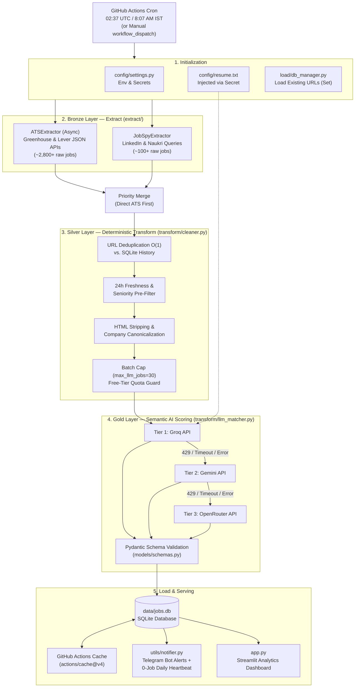

# Architecture Overview — HireSignal AI

**HireSignal AI** is an automated, zero-cost AI job intelligence ELT pipeline designed to extract, filter, semantically score, and deliver fresher-friendly tech job openings daily.

This document details the system's Medallion-inspired data pipeline, module boundaries, architectural trade-offs, fault-tolerance strategy, deployment topology, and scalability roadmap.

---

## 1. Design Principles

1. **Funnel Economics (Deterministic Before Probabilistic):** Eliminate ~99% of noise (duplicates, stale listings, senior titles, HTML markup) using fast, zero-cost Python rules before invoking LLM inference.
2. **High Availability at $0 Cost:** Combine direct public ATS JSON APIs, a 3-tier free LLM fallback chain, embedded SQLite storage, and GitHub Actions scheduled compute to run autonomously with zero infrastructure spend.
3. **Fault Isolation:** A failure in any single job board, ATS endpoint, or LLM provider degrades gracefully rather than crashing the daily pipeline.
4. **Decoupled Compute & Presentation:** Batch ingestion and AI scoring (`pipeline.py`) run headlessly on a schedule and write pre-computed gold records to SQLite, allowing the Streamlit analytics dashboard (`app.py`) to load instantaneously.

---

## 2. End-to-End System Architecture



---

## 3. Data Pipeline Layers (Medallion ELT)

### 3.1 Bronze Layer — Ingestion (`extract/`)
* **`extract/ats_extractor.py` (`ATSExtractor`):** Uses Python `asyncio` to concurrently fetch public JSON feeds directly from company Applicant Tracking Systems (**Greenhouse** and **Lever**). Direct ATS endpoints provide structured payloads, authentic postings directly from hiring teams, and minimal rate-limiting (~2,800+ raw jobs fetched in ~1–2 seconds).
* **`extract/jobspy_extractor.py` (`JobSpyExtractor`):** Supplements direct ATS feeds with targeted India fresher queries across public job boards (LinkedIn, Naukri).
* **Priority Ordering:** `raw_jobs = ats_jobs + jobspy_jobs` ensures verified direct-company ATS postings are prioritized ahead of scraped aggregator listings before the batch cap is applied.

### 3.2 Silver Layer — Deterministic Cleaning (`transform/cleaner.py`)
Compresses ~2,900+ raw daily postings down to a focused batch of ~7–30 unseen, relevant roles in under a second:
1. **Deduplication:** Filters out any listing whose URL already exists in the `existing_urls` set loaded from `data/jobs.db` ($O(1)$ average lookup time).
2. **Freshness Filtering:** Restricts processing to postings published within the last 24 hours to maximize early-applicant response rates.
3. **Noise & Seniority Pruning:** Eliminates obvious senior/executive roles before incurring LLM inference overhead.
4. **Normalization:** Strips raw HTML tags (reducing LLM token consumption by 40–60%) and resolves `company_raw` into a consistent `company_canonical` name.
5. **Quota Protection:** Enforces `max_llm_jobs=30` per run in `pipeline.py` to stay safely inside free-tier RPM/TPD limits.

### 3.3 Gold Layer — Semantic Evaluation (`transform/llm_matcher.py`)
Evaluates each cleaned job description against `config/resume.txt` using a **3-tier LLM fallback chain**:
* **Tier 1 (Primary):** Groq — low-latency inference for fast batch scoring.
* **Tier 2 (Secondary):** Gemini — automatic failover when Tier 1 hits rate limits (`429`) or transient outages.
* **Tier 3 (Tertiary):** OpenRouter — final safety net to guarantee batch completion.

Every model response is validated against strict **Pydantic schemas** (`models/schemas.py`) to guarantee strongly typed `ProcessedJob` records containing:
* `match_score` (0–100 integer)
* `is_fresher_friendly` (boolean guardrail against hidden experience requirements)
* `role_family` (categorization for dashboard filtering)
* `matching_skills` & `missing_skills` (explainable skill-gap analysis)
* `reasoning` (concise rationale for the score)
* `llm_provider_used` (observability metadata for provider auditing)

### 3.4 Load & Delivery (`load/`, `utils/`, `app.py`)
* **Persistence (`load/db_manager.py`):** Encapsulates all SQLite operations behind `DBManager` (Repository Pattern), persisting validated `ProcessedJob` objects to `data/jobs.db` with URL uniqueness enforcement.
* **Alerting (`utils/notifier.py`):** `TelegramNotifier` filters for jobs where `match_score >= MIN_MATCH_SCORE` **and** `is_fresher_friendly == True`. Messages are rendered in Telegram **HTML mode** with `html.escape()` applied to all dynamic fields, paced with `time.sleep(0.5)` to respect Telegram Bot API rate limits. When zero jobs qualify (or zero fresh jobs survive cleaning), a **0-job daily heartbeat** is sent to confirm pipeline health.
* **Analytics UI (`app.py`):** A Streamlit web dashboard reading directly from `data/jobs.db` for historical job exploration, role-family filtering, and skill-gap tracking.

---

## 4. Repository Structure & Module Boundaries

```text
hiresignal-ai/
├── .github/
│   └── workflows/
│       └── daily_pipeline.yml   # Autonomous daily CI/CD cron & cache orchestration
├── config/
│   ├── settings.py              # Centralized Pydantic settings (get_settings())
│   └── resume.txt               # Candidate resume (gitignored; injected via secret in CI)
├── extract/
│   ├── ats_extractor.py         # Async Greenhouse & Lever JSON API extractor
│   └── jobspy_extractor.py      # Targeted India fresher job-board extractor
├── transform/
│   ├── cleaner.py               # Silver-layer deduplication, freshness, HTML & entity cleaning
│   └── llm_matcher.py           # Gold-layer 3-tier LLM fallback & structured scoring engine
├── load/
│   └── db_manager.py            # SQLite persistence & O(1) deduplication URL loader
├── models/
│   └── schemas.py               # Pydantic data contracts (ProcessedJob, MatchResult)
├── utils/
│   ├── logger.py                # Structured module-level logging
│   └── notifier.py              # Telegram HTML card formatter, rate-pacer & heartbeat
├── data/
│   └── jobs.db                  # Runtime SQLite database (gitignored; mounted/cached)
├── assets/                      # Dashboard & Telegram alert screenshots
├── pipeline.py                  # Main ELT batch orchestrator
├── app.py                       # Streamlit analytics dashboard
├── Dockerfile                   # Container image specification
├── .dockerignore                # Excludes secrets, venv, cache & runtime DB from image layers
└── requirements.txt             # Python dependencies
```

---

## 5. Key Architectural Decisions & Trade-Offs

| Decision | Choice Made | Trade-Off & Rationale |
| :--- | :--- | :--- |
| **Ingestion Strategy** | Hybrid Direct ATS APIs + JobSpy | Direct ATS endpoints (Greenhouse/Lever) avoid brittle DOM scraping and datacenter IP bans, while JobSpy broadens coverage for India-specific fresher roles. |
| **AI Scoring vs. Keyword Matching** | Semantic LLM Scoring (post-Silver filter) | TF-IDF/keyword matching scores senior roles falsely high if they share tech keywords. LLM scoring detects hidden YoE traps (`is_fresher_friendly`) and produces explainable skill gaps. |
| **LLM Reliability** | 3-Tier Fallback (`Groq → Gemini → OpenRouter`) | Eliminates single-provider dependency and free-tier `429` failures without paying for dedicated enterprise throughput. |
| **Database Engine** | Embedded SQLite (`DBManager` Repository Pattern) | Zero-cost, zero-ops, ACID-compliant, and fast for single-tenant workloads (~10–50 rows/day). Isolating SQL in `DBManager` makes migrating to PostgreSQL/Supabase trivial later. |
| **Cron Scheduling** | Off-Peak UTC (`37 2 * * *` / 8:07 AM IST) | GitHub Actions experiences heavy global congestion at `:00` and `:30` UTC, which can delay or drop free-tier jobs. Off-peak minute scheduling improves reliability. |
| **Cloud State Persistence** | `actions/cache@v4` with `run_id` key + prefix restore | GitHub caches are immutable. Saving under `jobs-db-${{ github.run_id }}` while restoring via prefix `jobs-db-` rolls SQLite state forward across ephemeral daily runners. |
| **Telegram Formatting** | HTML Parse Mode + `html.escape()` | Markdown parsers frequently fail on tech symbols (`C++`, `Node.js`, underscores in URLs). Escaped HTML ensures 100% safe message rendering. |

---

## 6. Deployment, Persistence & Security Topology

### 6.1 Environment Comparison

| Environment | Execution Trigger | Database Persistence (`data/jobs.db`) | Secret Injection |
| :--- | :--- | :--- | :--- |
| **Local Dev** | `python pipeline.py` / `streamlit run app.py` | Local filesystem (`data/jobs.db`) | `.env` file via `python-dotenv` (gitignored) |
| **Docker** | `docker run` | Host bind mount (`-v ./data:/app/data`) | `--env-file .env` at runtime (never baked into image) |
| **GitHub Actions** | Daily Cron (`37 2 * * *`) & `workflow_dispatch` | `actions/cache@v4` (`jobs-db-` prefix restore) | Encrypted GitHub Repository Secrets (`env:` step block) |

### 6.2 Security Controls
* **Zero Hardcoded Credentials:** All API keys (`GROQ_API_KEY`, `GEMINI_API_KEY`, `OPENROUTER_API_KEY`), Telegram tokens (`TELEGRAM_BOT_TOKEN`, `TELEGRAM_CHAT_ID`), threshold tuning (`MIN_MATCH_SCORE`), and PII (`RESUME_TEXT`) are injected strictly via environment variables or encrypted GitHub Secrets.
* **Clean Docker Build Context:** `.dockerignore` explicitly excludes `.env`, `config/resume.txt`, `data/`, `venv/`, and `.git/` so sensitive files never enter Docker image layers.
* **Runtime Resume Materialization:** In CI/CD, `RESUME_TEXT` is written to `config/resume.txt` ephemerally inside the runner (`printf "%s" "$RESUME_TEXT" > config/resume.txt`) and destroyed automatically when the runner terminates.

---

## 7. Failure Modes & Resilience Matrix

| Failure Scenario | Observed Cause | System Behavior & Mitigation |
| :--- | :--- | :--- |
| **ATS Endpoint Returns `404`** | Company migrates off Greenhouse/Lever | Logged as `WARNING`; extractor skips the dead board and continues fetching remaining companies. |
| **Job Board Returns `429`** | LinkedIn rate-limits GitHub datacenter IP | Caught per query; JobSpy returns results from unblocked queries while ATS jobs remain unaffected. |
| **Primary LLM Quota Exhausted** | Groq RPM/TPD limit reached | Automatic sequential failover to Gemini (Tier 2) and OpenRouter (Tier 3). |
| **Malformed LLM JSON Output** | Model deviates from expected structure | Pydantic validation catches the error; falls back to next provider or skips the single job safely. |
| **0 Qualifying Fresher Jobs** | Quiet hiring day or all roles too senior | Sends a concise 0-job Telegram heartbeat instead of staying silent, proving the cloud run succeeded. |
| **Empty / Duplicate Cache Day** | All extracted URLs already in `jobs.db` | Pipeline exits early after Silver layer without wasting LLM calls and triggers the 0-job heartbeat. |

---

## 8. Scalability Roadmap (v1.0 → v2.0 Multi-Tenant SaaS)

HireSignal AI v1.0 is optimized for a **single-tenant, zero-cost** personal workflow. Scaling to **10,000+ concurrent job seekers** requires decoupling shared ingestion from per-user matching:

1. **Managed Cloud Database (`PostgreSQL` + `pgvector`):**
   * Replace cached SQLite with a centralized cloud database (e.g., Supabase) so both the scheduled pipeline and a public web frontend share live state without GitHub's 7-day cache eviction risk.
2. **Centralized Ingestion Fleet (Scrape Once, Match Many):**
   * Run a single shared extraction fleet (orchestrated via Airflow/Prefect with rotating residential proxies for `429`-resistant job-board scraping) that writes normalized jobs once into PostgreSQL.
3. **Two-Stage Hybrid Retrieval (Embeddings → LLM Reranking):**
   * Compute vector embeddings once per job and once per user resume. Use `pgvector` cosine similarity to retrieve only the top ~15 semantically relevant fresher roles per user before calling an LLM—cutting inference costs by >95%.
4. **Asynchronous Fan-Out Queues:**
   * Introduce **Redis + Celery** (or AWS SQS) to parallelize per-user LLM scoring and notification delivery (Telegram, Email, Slack) with exponential backoff and dead-letter queues.
5. **Multi-User Web Stack:**
   * Transition the UI layer from Streamlit to a **FastAPI** backend + **Next.js** frontend with OAuth authentication, PDF resume parsing, and an integrated application status tracker (`New`, `Applied`, `Interviewing`, `Rejected`).