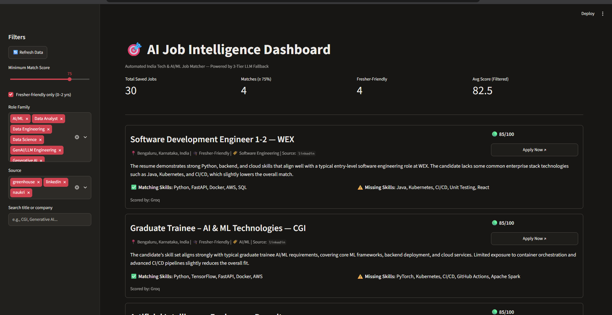
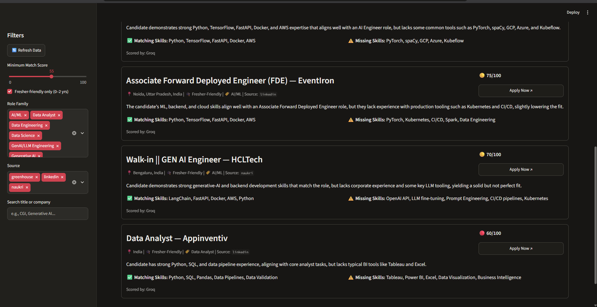
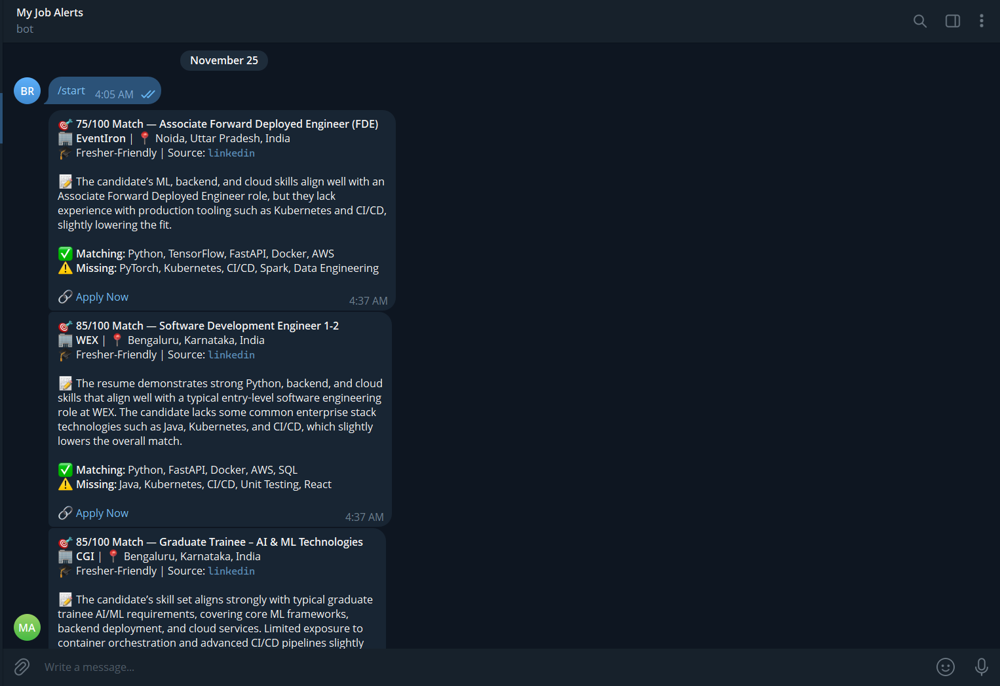

# AI Job Intelligence & Matching Pipeline

An automated Python pipeline that discovers entry-level technology roles across India, removes duplicates and obvious senior or non-technical listings, compares each role with a candidate resume, stores the explainable results in SQLite, and presents them in a Streamlit dashboard and Telegram alerts.

The project is designed to reduce manual job searching while keeping costs low. It uses public ATS APIs and job-board extraction for collection, deterministic filters before AI for cost control, and a three-provider LLM fallback chain for resume-to-job matching.

## Screenshots

### Streamlit dashboard - overview and job cards



The dashboard combines a high-level summary with searchable, filterable job cards:

- **KPI cards** show the total number of saved jobs, jobs meeting the selected threshold, fresher-friendly jobs, and the filtered average score.
- **Minimum Match Score** controls the least accepted score shown in the dashboard.
- **Fresher-friendly only** removes roles that require more than the configured entry-level experience range.
- **Role Family** and **Source** filters narrow results to categories such as AI/ML, Data Analyst, or Software Engineering and sources such as Greenhouse, LinkedIn, or Naukri.
- **Search** matches text in job titles or canonical company names.
- Every job card includes the score, location, remote/fresher labels, source, AI reasoning, matching skills, missing skills, provider used, and an **Apply Now** link.
- Match scores are color-coded: green for 85 and above, yellow for 70-84, and red below 70.

### Streamlit dashboard - lower score range and filters



The second view demonstrates the dashboard at a lower score threshold. This makes borderline opportunities visible instead of hiding them completely. Lower-match cards remain useful for identifying roles that may need a few extra skills or whose descriptions may have been interpreted conservatively.

The sidebar is the primary control panel: lowering the threshold or changing the role, source, fresher, or text filters immediately changes the KPI totals and visible job cards.

### Telegram alerts



Telegram provides a mobile-friendly notification layer. When a newly processed job meets the alert threshold and is marked fresher-friendly, the bot sends:

- Match score and job title
- Company and location
- Remote and fresher-friendly status
- Source
- A concise score explanation
- Matching and missing skills
- A direct application link

This is intentionally a high-signal subset of the dashboard results rather than a notification for every job found.

## Architecture

```text
Candidate resume
       |
       v
+-------------------+       +-----------------------+
| Job sources       |       | config/resume.txt     |
| - Greenhouse ATS  |       +-----------------------+
| - Lever ATS       |
| - LinkedIn        |
| - Naukri          |
+-------------------+
       |
       v
Extract
- Public ATS APIs
- JobSpy searches
- 24-hour default freshness window
       |
       v
Transform - Silver
- Skip duplicate URLs
- Normalize and strip HTML
- Remove stale jobs
- Remove senior/leadership titles
- Filter relevant technology titles
- Resolve known company names
       |
       v
Transform - Gold
- Send the candidate resume and job description to an LLM
- Validate the response through Pydantic
- Produce score, role family, skill gaps, and reasoning
- Fall back across Groq, Gemini, and OpenRouter
       |
       v
Load
SQLite database: data/jobs.db
       |
       +--------------------------+
       v                          v
Streamlit dashboard          Telegram notifications
Filtering and review         High-score fresher matches
```

## Pipeline Flow

### 1. Extract

The project supports two extraction paths:

- **Direct ATS APIs:** Greenhouse and Lever boards for configured companies.
- **Job boards:** LinkedIn and Naukri searches through `python-jobspy`.

Configured searches cover AI engineer, data analyst, Python developer, and machine learning roles in India. ATS and JobSpy results are combined, with direct ATS jobs added first.

### 2. Transform - Silver

The cleaner in `transform/cleaner.py` acts as a low-cost guardrail before the LLM:

- Skips URLs already saved in SQLite or repeated in the current run.
- Removes titles containing senior, staff, principal, lead, manager, director, and similar terms.
- Removes obvious non-technical categories such as accounting, sales, legal, recruitment, and marketing.
- Keeps titles associated with AI/ML, data, Python, software, engineering, developer, backend, QA, testing, and intern roles.
- Rejects listings older than the configured freshness window.
- Removes HTML and extra whitespace from descriptions.
- Uses RapidFuzz to resolve common company names to canonical values.

### 3. Transform - Gold

`transform/llm_matcher.py` sends a resume and a shortened job description to the configured LLM providers. The prompt asks for a 0-100 match score, role family, matching skills, missing skills, fresher eligibility, and concise reasoning.

The fallback order is:

1. Groq with `openai/gpt-oss-20b`
2. Google Gemini with `gemini-3.5-flash-lite`
3. OpenRouter with `openrouter/free`

The provider chain continues until the model returns valid JSON that passes the Pydantic `LLMMatchResult` schema. The provider that succeeds is saved with the job record.

The evaluation rules cover:

- Scam or paid-training and consultancy-trap indicators
- India, remote, and visa-sponsorship eligibility
- 0-2 year and graduate-trainee suitability
- Automatic limitations for roles that require 2+ years

### 4. Load

`load/db_manager.py` stores processed jobs in `data/jobs.db`. The URL is a primary key, so saving the same listing again is prevented. The database tracks the title, company, location, source, posting date, score, role family, skills, reasoning, remote/fresher flags, and successful LLM provider.

### 5. Notify

Telegram notifications are enabled only when both a bot token and chat ID are configured. The notifier sends only new results that meet the configured threshold and are marked fresher-friendly.

## Project Structure

```text
Job Search Application/
|-- app.py                    # Streamlit dashboard
|-- pipeline.py               # Extract, transform, load, and notify workflow
|-- config/
|   |-- settings.py           # Environment-backed settings
|   `-- resume.txt            # Candidate resume text
|-- extract/
|   |-- ats_extractor.py      # Greenhouse and Lever API extraction
|   `-- jobspy_extractor.py   # LinkedIn and Naukri extraction
|-- transform/
|   |-- cleaner.py            # HTML cleanup, freshness, dedupe, filters
|   `-- llm_matcher.py        # Resume matching and provider fallback
|-- load/
|   `-- db_manager.py         # SQLite initialization and persistence
|-- models/
|   `-- schemas.py            # Pydantic input and output schemas
|-- utils/
|   |-- logger.py             # Pipeline logging
|   `-- notifier.py           # Telegram delivery
|-- assets/                   # Dashboard and Telegram screenshots
|-- data/jobs.db              # Persistent SQLite job database
|-- Dockerfile                # Container runtime
|-- requirements.txt          # Python dependencies
`-- .env.example              # Environment variable template
```

## Technology Stack

| Area | Technology |
|---|---|
| Language | Python 3.11 |
| Data validation | Pydantic |
| HTTP and async extraction | aiohttp, asyncio |
| Job-board extraction | python-jobspy |
| HTML and date cleanup | Beautiful Soup, dateparser |
| Company and title matching | RapidFuzz and regular expressions |
| LLM integration | Groq, Google Gemini, OpenRouter through OpenAI-compatible clients |
| Database | SQLite |
| Dashboard | Streamlit |
| Notifications | Telegram Bot API |
| Deployment | Docker |

## Setup

### Prerequisites

- Python 3.11 or newer
- Internet access
- At least one LLM API key for scoring
- Optional Telegram bot token and chat ID
- Optional Docker installation

### Local installation

```powershell
python -m venv venv
venv\Scripts\Activate.ps1
python -m pip install --upgrade pip
pip install -r requirements.txt
```

Create the environment file:

```powershell
Copy-Item .env.example .env
```

Paste the candidate resume into `config/resume.txt`:

```powershell
Copy-Item "<path-to-your-resume.txt>" config\resume.txt
```

Then edit `.env` and add the provider and Telegram values required for your setup.

### Run the pipeline

```powershell
python pipeline.py
```

The default run scores up to 30 cleaned jobs. A run:

1. Loads the resume.
2. Extracts ATS and job-board listings.
3. Removes duplicates and irrelevant or stale listings.
4. Evaluates jobs through the configured LLM fallback chain.
5. Saves new records to SQLite.
6. Sends qualifying Telegram alerts.

Logs are written through the project logger and can be reviewed in `logs/pipeline.log` if logging is enabled in the runtime environment.

### Launch the dashboard

```powershell
streamlit run app.py
```

Open `http://localhost:8501`.

## Environment Variables

| Variable | Required | Purpose |
|---|---|---|
| `GROQ_API_KEY` | Optional tier | First LLM provider |
| `GEMINI_API_KEY` | Optional tier | Second LLM provider |
| `OPENROUTER_API_KEY` | Optional tier | Third LLM provider |
| `TELEGRAM_BOT_TOKEN` | For Telegram | Bot authentication token |
| `TELEGRAM_CHAT_ID` | For Telegram | Destination chat ID |
| `MAX_JOB_AGE_HOURS` | Optional | Freshness window; default is 24 hours |
| `MIN_NOTIFY_SCORE` | Optional | Current settings field for notification policy; default in the notifier is 75 |
| `DB_PATH` | Optional | SQLite path; default is `data/jobs.db` |
| `RESUME_PATH` | Optional | Resume path; default is `config/resume.txt` |

At least one LLM key is needed to score jobs. Telegram variables are optional; without them, the pipeline still saves and displays jobs.

Keep `.env` private and never commit API keys or the Telegram bot token.

## Docker

Build the image:

```powershell
docker build -t job-intel-pipeline .
```

Run the Streamlit dashboard:

```powershell
docker run --rm -p 8501:8501 --env-file .env -v "${PWD}\data:/app/data" job-intel-pipeline
```

Run one pipeline execution:

```powershell
docker run --rm --env-file .env `
  -v "${PWD}\data:/app/data" `
  -v "${PWD}\config\resume.txt:/app/config/resume.txt:ro" `
  job-intel-pipeline python pipeline.py
```

The mounted `data` directory preserves `jobs.db` between dashboard and pipeline runs.

## Telegram setup

1. Create a bot with BotFather and copy its token.
2. Send a message to the bot.
3. Get the numeric chat ID through the Telegram `getUpdates` API or a bot service.
4. Add `TELEGRAM_BOT_TOKEN` and `TELEGRAM_CHAT_ID` to `.env`.
5. Run `python pipeline.py`.

Alerts are sent for fresher-friendly records with a match score of at least 75 by default.

## Performance and reliability notes

- The Silver cleaner prevents expensive LLM calls for duplicates, stale listings, senior roles, and unrelated titles.
- Description text is limited to 4,000 characters before AI matching.
- The pipeline caps a run at 30 jobs by default and its scoring loop supports a configurable 80-job upper run value.
- Each provider call is separated by pacing delays to reduce free-tier rate-limit issues.
- SQLite URL primary keys provide incremental storage and dashboard deduplication.
- Streamlit caches dashboard data for 60 seconds and exposes a manual refresh button.
